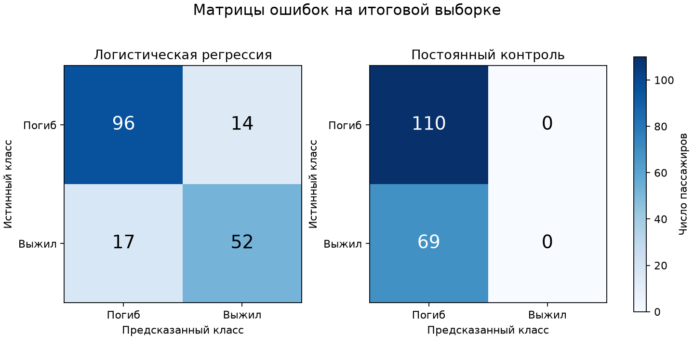
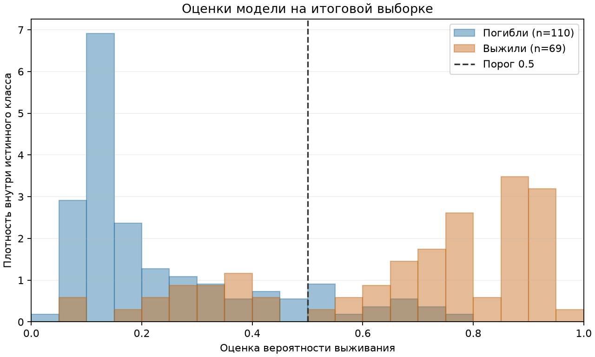
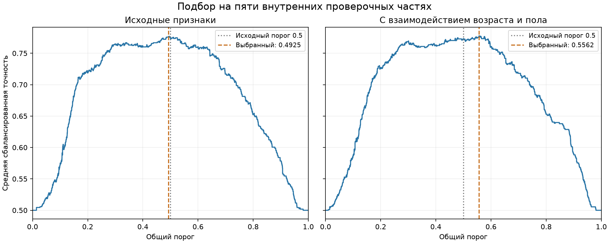
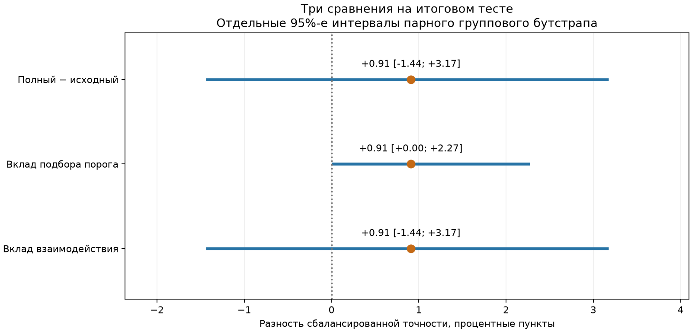
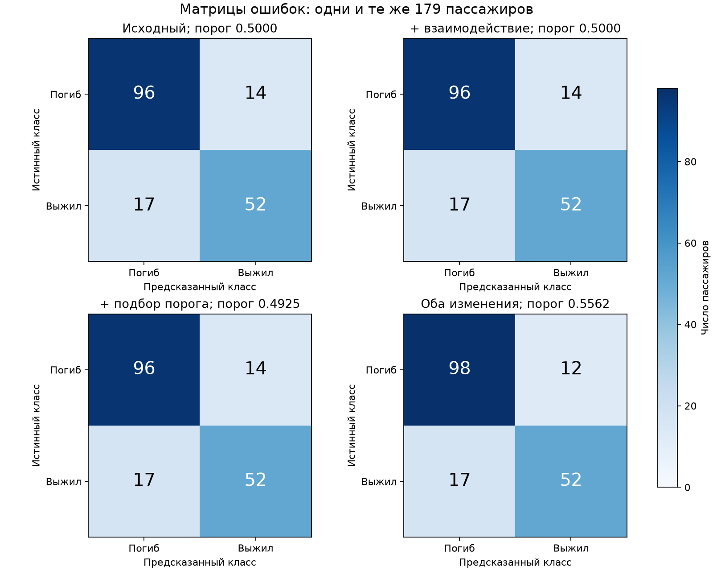
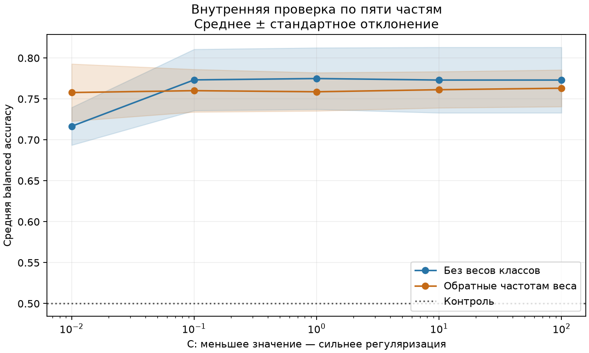

# Titanic: прогнозирование выживания пассажиров

Учебный проект по предсказанию выживания пассажиров Titanic на основе
табличных данных. Задача относится к бинарной классификации: целевая
переменная принимает значения «выжил» и «не выжил».

Исходная логистическая регрессия получила сбалансированную точность
(balanced accuracy) **0.8132**, постоянный контроль — **0.5000**
на 179 пассажирах из новых билетных групп. Добавление взаимодействия
возраста и пола вместе с подбором порога дало **0.8223**. Прирост
составил **0.91 процентного пункта**, но его 95%-й интервал включает ноль:
убедительное улучшение на этом тесте не установлено.

Проект включает выбор исходной модели и проверку двух изменений
на тех же разбиениях. [Результаты](#результаты) содержат сравнения,
разбор ошибок и ограничения. Подробная выгрузка последней серии —
в [отчёте о взаимодействии и пороге](reports/hw2/report.md).

После [подготовки окружения](#окружение) серия четырёх вариантов запускается так:

```bash
bash scripts/run_hw2.sh
```

Команды исходного эксперимента, отдельных этапов и просмотра истории
собраны в разделе [«Запуск и проверка»](#запуск-и-проверка).

## Постановка задачи

Решается ретроспективная задача: по исторической записи о пассажире
предсказать, выжил ли он. Доступность исходных сведений определяется
составом опубликованной таблицы.

- Объект наблюдения — один пассажир, представленный одной строкой.
- Вход `X` состоит из семи исходных полей: `Sex`, `Age`, `Pclass`,
  `Fare`, `SibSp`, `Parch`, `Embarked`. Столбец `Survived` в него не входит.
- Целевая переменная `y` — `Survived`: 1 означает выживание, 0 — гибель.
- Одно предсказание — одна метка класса для одного пассажира.

Исследовательская цель — проверить предсказательную полезность сведений
о пассажирах, получить воспроизводимую точку отсчёта и оценить влияние
нового признака и правила получения метки. Качество оценивается
на пассажирах, чьи метки не использовались
при обучении и чьи билетные группы целиком отсутствовали в обучающей
части. Настройки выбираются внутренней перекрёстной проверкой, итоговое
качество оценивается на отдельной фиксированной выборке.
Результаты характеризуют предсказательные связи в исторических
данных. Причинные эффекты отдельных признаков из такой проверки не следуют.

### Гипотезы

Предполагается, что признаки пассажира содержат информацию о выживании,
поэтому логистическая регрессия с L2-регуляризацией на этих признаках покажет более высокую
сбалансированную долю правильных ответов (balanced accuracy) на новых
пассажирах итоговой выборки из билетных групп, отсутствовавших в обучении,
чем постоянное предсказание самого частого класса обучающей части.
При оценке оба класса должны иметь одинаковую важность независимо
от их численности.

Для проверки исходной гипотезы конфигурация выбирается из десяти вариантов силы
регуляризации и весов классов по среднему balanced accuracy внутренней
проверки. Затем модель заново обучается на всём наборе для выбора настроек
и сравнивается с контролем на одном фиксированном итоговом тесте при
пороге 0.5. Наблюдаемое преимущество определяется положительной разностью
balanced accuracy модели и контроля на этом тесте. Результат проверки
приведён в разделе [«Результаты»](#результаты).

В исходном опыте модель распознала лишь 1 из 18 выживших мужчин.
Это наблюдение мотивировало две дополнительные гипотезы:

- Общий порог, выбранный по сбалансированной точности, может улучшить
  соотношение полноты погибших и выживших по сравнению с порогом 0.5.
- Взаимодействие возраста и пола может улучшить предсказания, позволяя
  модели учитывать различную связь возраста с выживанием у мужчин и женщин.

Обе гипотезы проверяются при фиксированных лучших настройках исходной
модели. Ошибки исходного опыта не доказывают причины недостатков или
будущий выигрыш. Повторное использование уже изученного теста учитывается
в [ограничениях выводов](#выводы-и-ограничения).

### Исследовательские вопросы

1. Как веса классов влияют на balanced accuracy и полноту выживших?
   Для каждого фиксированного `C` сравниваются `class_weight=None` и
   `"balanced"` на одинаковых пяти внутренних разбиениях при пороге 0.5.
   Сопоставляются средняя balanced accuracy и полноты обоих классов:
   увеличение полноты выживших может сопровождаться потерями другого класса.
2. Насколько качество зависит от силы регуляризации? Для каждого режима
   весов сравниваются средние balanced accuracy по сетке `C`, разница
   между лучшим и худшим средними и разброс по внутренним частям.
   Первые два вопроса используют результаты того же перебора настроек.
3. Можно ли улучшить balanced accuracy подбором порога вместо 0.5 при
   неизменных признаках, подготовке и настройках модели? Порог выбирается
   на пяти внутренних проверочных частях отдельно для каждого набора
   признаков; эффект оценивается на фиксированном итоговом тесте.
4. Что даёт взаимодействие возраста и пола при сохранении исходного возраста?
   Сравниваются модели с признаком и без него при пороге 0.5 и при одинаковой
   процедуре подбора собственного порога. Два отключения компонентов полной
   версии показывают их вклад при наличии второго компонента.

### Основная метрика

Основная метрика — balanced accuracy: среднее арифметическое полнот
двух классов. Полнота класса — доля правильно распознанных пассажиров
среди всех пассажиров этого класса:

```text
balanced_accuracy = (recall_survived + recall_not_survived) / 2
```

Выбор соответствует гипотезе: качество распознавания каждого класса
получает одинаковый вес, хотя классы представлены в данных в разных
количествах. Метрика рассчитывается по предсказанным меткам классов;
качество оценок вероятностей она не измеряет. Высокая полнота одного
класса может компенсировать низкую полноту другого в итоговом среднем.

Используется обычная шкала от 0 до 1. Например, на проверочной части
с обоими классами постоянное предсказание одного класса даёт 0,5:
полнота одного класса равна 1, другого — 0. Это расчётное свойство
метрики, независимо от качества модели с признаками.

Определение: [документация scikit-learn](https://scikit-learn.org/stable/modules/model_evaluation.html#balanced-accuracy-score).

### Контрольное сравнение

Контрольный классификатор всегда предсказывает самый частый класс
обучающей части. Например, если в ней больше невыживших, он предсказывает
«не выжил» каждому проверочному пассажиру независимо от его признаков.
Это простая воспроизводимая точка отсчёта для проверки полезности признаков.

Частый класс определяется только по меткам соответствующей обучающей
части. Модель с признаками и контроль оцениваются на одних и тех же
проверочных записях. Контроль реализован через
[`DummyClassifier(strategy="most_frequent")`](https://scikit-learn.org/stable/modules/generated/sklearn.dummy.DummyClassifier.html).
Его теоретическая balanced accuracy равна 0,5, если проверочная часть
содержит оба класса. Это выполняется во всех частях текущего эксперимента.

### Базовая модель

Базовая модель с признаками —
[логистическая регрессия](https://scikit-learn.org/stable/modules/linear_model.html#logistic-regression)
из scikit-learn. Она вычисляет взвешенную сумму подготовленных признаков
и преобразует её в оценку вероятности выживания.

Модель выбрана как простая воспроизводимая точка отсчёта: она быстро
обучается на небольших табличных данных, а вычисление предсказаний можно
объяснить через коэффициенты при подготовленных признаках. Она сама
не строит сочетания признаков автоматически. Взаимодействие возраста
и пола вводится отдельным преобразованием при сохранении той же модели.

Используется L2-регуляризация: к функции потерь добавляется положительный
штраф, пропорциональный сумме квадратов коэффициентов признаков. Свободный
член не штрафуется. В сочетании с полным кодированием категорий этот штраф
устраняет неоднозначность коэффициентов, вызванную избыточностью индикаторов,
и ограничивает чрезмерные веса.

### Настройки обучения и предсказания

При выборе исходной модели проверяются все сочетания пяти значений `C`
и двух способов задания весов классов. Остальные параметры фиксированы:

| Параметр | Значения | Назначение |
| --- | --- | --- |
| `C` | `0.01`, `0.1`, `1`, `10`, `100` | Обратная сила регуляризации; меньшее значение задаёт более сильный штраф |
| `class_weight` | `None`, `"balanced"` | Одинаковый вес каждого пассажира либо одинаковый суммарный вес каждого класса |
| `l1_ratio` | `0` | Чистая L2-регуляризация |
| `solver` | `"lbfgs"` | Численный поиск коэффициентов |
| `fit_intercept` | `True` | Свободный член модели, не штрафуемый выбранным алгоритмом |
| `max_iter` | `1000` | Верхняя граница числа итераций оптимизатора |
| `tol` | `1e-4` | Допуск остановки оптимизатора |
| Порог при выборе исходной модели | `0.5` | Фиксированное правило бинарного предсказания |

Небольшая сетка `C` охватывает несколько порядков силы регуляризации,
позволяя обосновать выбор результатами внутренней проверки. Это конечный
набор кандидатов, а не гарантия нахождения оптимума среди всех возможных
значений параметров.

В последующем сравнении признака и порога используются выбранные
`C=1`, `class_weight=None`; параметры решателя и регуляризации сохраняются.
Повторного поиска гиперпараметров нет. Преобразования и коэффициенты
каждой модели заново обучаются на соответствующей обучающей части.

При `class_weight=None` все пассажиры имеют единичный вес в функции
потерь. При `class_weight="balanced"` вес класса вычисляется как
`n_samples / (n_classes * class_count)`, где количества относятся только
к данным соответствующего обучения. Для двух классов это выравнивает
их суммарные веса. Например, при условных 600 невыживших и 400 выживших
вес одного выжившего в 1.5 раза выше веса одного невыжившего. В каждом
внутреннем обучении и итоговом обучении веса определяются заново.
Взвешивание меняет функцию потерь при обучении; определение balanced
accuracy при оценке остаётся прежним.

Алгоритм Бройдена—Флетчера—Гольдфарба—Шанно с ограниченной памятью
(`lbfgs`) использует градиент и приближение кривизны функции потерь.
Он поддерживает выбранный квадратичный штраф без штрафования свободного
члена. Предел итераций и допуск фиксируются; сходимость каждого обучения
проверяется при запуске. Значения и смысл параметров описаны в
[документации LogisticRegression](https://scikit-learn.org/stable/modules/generated/sklearn.linear_model.LogisticRegression.html).

При выборе исходной модели метка получается методом `predict`:
вероятность выживания выше 0.5 соответствует классу 1, иначе — классу 0.
В серии четырёх вариантов правило обобщается до `probability > threshold`;
при точном равенстве получается класс 0. Используется либо 0.5, либо
порог из [внутреннего подбора](#подбор-общего-порога). Для всех пассажиров
одного варианта порог одинаков.
[Описание перехода от оценок к меткам](https://scikit-learn.org/stable/modules/classification_threshold.html).

Поиск исходной конфигурации выполняет 50 внутренних обучений
логистической регрессии
(10 конфигураций по 5 частей) и одно новое обучение выбранной конфигурации
на всех данных для выбора настроек. Контрольный классификатор обучается
отдельно: пять раз внутри проверки и один раз на всех 712 обучающих записях.
Серия сравнения признака и порога требует 12 обучений: пять внутренних
и одно итоговое для каждого из двух наборов признаков. Варианты одного
набора используют общую модель; перебор порогов не требует переобучения.
Все обучения завершились без предупреждений о сходимости.

### Входные признаки

Оба набора признаков используют семь полей исходной таблицы:

| Поле | Содержание |
| --- | --- |
| `Sex` | Пол |
| `Age` | Возраст |
| `Pclass` | Класс билета |
| `Fare` | Стоимость билета |
| `SibSp` | Количество братьев, сестёр и супругов на борту |
| `Parch` | Количество родителей и детей на борту |
| `Embarked` | Порт посадки |

Набор охватывает демографические сведения, условия поездки и информацию
о родственниках. Каждый вход имеет понятный смысл; новые признаки из
имени, билета или каюты не извлекаются. Полезность исходного набора
проверена сравнением модели с контрольным предсказанием.

Расширенный набор дополнительно содержит один числовой признак
`Age * male`, где `male` равен 1 для мужчины и 0 для женщины.
Исходный `Age` сохраняется. До масштабирования возрастной вклад
в линейную часть можно записать как `a * Age + c * Age * male`:
у женщин возрастной коэффициент равен `a`, у мужчин — `a + c`.
Например, в возрасте 30 лет новое значение равно 30 для мужчины
и 0 для женщины, а исходный возраст в обоих случаях остаётся равным 30.
Ноль в дополнительном столбце не устраняет влияние возраста у женщин.

`PassengerId` исключён из признаков как идентификатор записи. `Name`
и `Ticket` в признаки модели не включаются: извлечение титулов или сведений о группах
пассажиров требует отдельных правил. `Cabin` также исключён: поле
не заполнено у 687 из 891 пассажира размеченного набора, а представление
номера каюты требует отдельного решения.

### Обработка пропусков

Пропуски в выбранных полях заполняются по следующим правилам:

| Поле | Правило |
| --- | --- |
| `Age` | Медиана известных возрастов обучающей части |
| `Fare` | Медиана известных стоимостей билета обучающей части |
| `Embarked` | Самый частый известный порт посадки обучающей части |

Медиана менее чувствительна к крайним значениям, чем среднее. Заполнение
порта самым частым значением сохраняет простую обработку двух исходных
пропусков без отдельной редкой категории. Это технические подстановки;
истинные отсутствующие значения остаются неизвестными. Записи из-за
пропусков в этих полях не удаляются.

Сначала размеченные данные разделяются на обучающую и проверочную части.
Значения заполнения вычисляются только по обучающей части и затем
используются для обеих частей. Проверочные данные и исходный `test.csv`
не участвуют в расчёте этих значений. Если протокол включает несколько
разбиений, статистики рассчитываются заново для обучающей части каждого
разбиения. Это предотвращает утечку информации через заполнение пропусков.

Правило применяется в каждом внутреннем разбиении и при итоговом обучении
на всех примерно 80%, выделенных для выбора настроек. В итоговом конвейере
медианы `Age` и `Fare` равны 28 и 13.8604, самый частый порт — `S`.
Эти значения получены только по 712 обучающим записям; внутри проверки
каждая обучающая часть имеет собственные статистики.
Правила поддерживаются стандартным
[`SimpleImputer`](https://scikit-learn.org/stable/modules/generated/sklearn.impute.SimpleImputer.html);
порядок обучения преобразований соответствует
[рекомендациям по предотвращению утечки](https://scikit-learn.org/stable/common_pitfalls.html#data-leakage).

Для взаимодействия возраст сначала заполняется медианой обучающей части
в исходных годах, затем умножается на индикатор мужчины. При пропуске
возраста взаимодействие равно этой медиане для мужчины и нулю для женщины.
Преобразование реализовано в [`src/features.py`](src/features.py)
и обучается внутри каждого конвейера, включая внутренние разбиения.

### Кодирование категорий

`Sex`, `Embarked` и `Pclass` преобразуются в отдельные столбцы-индикаторы
для каждой категории (one-hot encoding). Сохраняется полный набор
индикаторов без удаления опорной категории. Категории определяются
только по обучающей части; на проверочной применяется тот же кодировщик.
`Age`, `Fare`, `SibSp` и `Parch` остаются числовыми признаками;
в расширенном наборе к ним добавляется взаимодействие `Age * male`.

Для `Pclass` такое представление позволяет оценивать вклад каждого класса
билета отдельно, без предположения о равных шагах в линейной сумме модели
между кодами 1, 2 и 3. Полное кодирование в сочетании с L2-регуляризацией
сохраняет одинаковый подход к штрафованию коэффициентов всех категорий.
Линейная зависимость индикаторов и свободного члена остаётся, но
положительный квадратичный штраф устраняет соответствующую неоднозначность
коэффициентов.

Используется [`OneHotEncoder`](https://scikit-learn.org/stable/modules/generated/sklearn.preprocessing.OneHotEncoder.html)
без удаления столбцов (`drop=None`) и с `handle_unknown="ignore"`.
Допустимая категория, отсутствовавшая в обучающей части, представляется
нулями во всех индикаторах соответствующего поля. Например, если при
обучении встретились только порты `C` и `S`, порт `Q` при проверке получает
представление `[0, 0]`. Модель использует остальные признаки и свободный
член, но отдельный эффект неизвестного порта не оценён. Значения вне
допустимой схемы исходных данных отклоняются загрузчиком.

### Масштабирование числовых признаков

После заполнения пропусков `Age`, `Fare`, `SibSp` и `Parch` стандартизируются
с помощью [`StandardScaler`](https://scikit-learn.org/stable/modules/generated/sklearn.preprocessing.StandardScaler.html):
из значения вычитается среднее обучающей части, затем результат делится
на её стандартное отклонение. Для постоянного обучающего столбца
используется масштаб 1. Категориальные индикаторы сохраняются в виде `0/1`.

В расширенном наборе уже вычисленное взаимодействие стандартизируется
как отдельный числовой столбец. Умножается возраст в годах, до его
масштабирования. Среднее и масштаб взаимодействия также определяются
только по обучающей части; после центрирования его значение у женщин
уже не обязано быть нулевым.

Масштабирование устраняет зависимость штрафа L2 от единиц измерения
числового признака. Без него переход от возраста в годах к возрасту
в месяцах требует уменьшить коэффициент в 12 раз для того же вклада
в предсказание, а квадрат коэффициента уменьшается в 144 раза.
Стандартизация даёт одинаковое представление возраста в обоих случаях.
Она не делает распределения нормальными и остаётся чувствительной
к крайним значениям.

Среднее и стандартное отклонение рассчитываются после заполнения пропусков
только на обучающей части. Для проверочной части используются сохранённые
значения. При нескольких разбиениях все статистики заново определяются
внутри каждой обучающей части. Исходный `test.csv` в их расчёте не участвует.

### Обработка и модель

Обработка числовых признаков, категорий и, при включении,
взаимодействия объединяется в
[`ColumnTransformer`](https://scikit-learn.org/stable/modules/generated/sklearn.compose.ColumnTransformer.html),
который вместе с логистической регрессией составляет единый конвейер
([`Pipeline`](https://scikit-learn.org/stable/modules/generated/sklearn.pipeline.Pipeline.html)).
Обучение конвейера определяет значения заполнения, категории, масштабы
и коэффициенты модели только по соответствующей обучающей части.

Обученный конвейер сохраняется целиком. Отдельный этап оценки загружает
его и применяет сохранённые преобразования к проверочным записям.
Графики строятся по сохранённым результатам оценки. Так модель получает
одинаково подготовленные признаки при обучении и последующем применении.

Конвейер реализован в [`src/experiment.py`](src/experiment.py),
обучение исходной модели — в [`src/train.py`](src/train.py),
серия четырёх вариантов — в [`src/hw2.py`](src/hw2.py).

## Протокол оценки

Локальная проверка строится на размеченном `train.csv`. Единица разбиения —
группа пассажиров с одинаковым значением `Ticket`. При каждом локальном
разбиении такая группа целиком относится либо к обучающей, либо
к проверочной части; один билет не может присутствовать в обеих частях.

Такое разделение проверяет перенос предсказаний на пассажиров из целиком
новых билетных групп. При разбиении отдельных строк участники одной
поездки могли бы оказаться по обе стороны границы, что отвечало бы
другому сценарию: предсказанию для новых пассажиров с возможным присутствием
их группы в обучении. Подход соответствует
[проверке на непересекающихся группах](https://scikit-learn.org/stable/modules/cross_validation.html#cross-validation-iterators-for-grouped-data).

`Ticket` используется только для формирования разбиения и не передаётся
модели как входной признак. Предсказания и balanced accuracy рассчитываются
по пассажирам. Контрольный классификатор, исходная модель и все её варианты
используют одни и те же проверочные записи.

Общий билет не является точным идентификатором семьи: родственники могут
иметь разные билеты, а общий билет не доказывает родство. Группировка
предотвращает пересечение одинаковых билетов, но не гарантирует полной
независимости наблюдений. Из-за неделимости групп точные размеры частей
и доли классов сохранить сложнее.

### Разделение данных

Используется
[`StratifiedGroupKFold`](https://scikit-learn.org/stable/modules/generated/sklearn.model_selection.StratifiedGroupKFold.html)
с `n_splits=5`, `shuffle=True`, `random_state=42`. Алгоритм распределяет
целые билетные группы и старается сохранить исходные доли классов.
При формировании частей метки используются для сохранения долей классов.
Метки итоговой выборки не используются для обучения преобразований,
модели или выбора настроек.

Первая выдаваемая проверочная часть, с индексом 0, заранее назначается
итоговой тестовой выборкой, примерно 20% записей. Остальные четыре части
объединяются в набор для обучения и выбора настроек, примерно 80% записей.
Номер итоговой части и начальное состояние генератора случайных чисел
не подбираются по результатам модели. Сохраняются идентификаторы пассажиров
в каждой части и фактические размеры и доли классов. Исходный `test.csv`
без меток в локальном протоколе не используется.

Сравнение признака и порога сохраняет точные идентификаторы итогового теста
и пяти внутренних частей исходного опыта. Новая серия воспроизводит
разбиения из данных и сверяет их контрольную сумму с сохранённым результатом.

### Выбор настроек исходной модели

Набор из примерно 80% записей заново разбивается на пять внутренних частей
с помощью `StratifiedGroupKFold` с теми же параметрами. Для каждой
конфигурации выполняются пять отдельных обучений: на четырёх внутренних
частях с проверкой на оставшейся. Все конфигурации и контрольный
классификатор используют одинаковые внутренние разбиения. В каждом
обучении преобразования признаков и постоянный класс контроля определяются
только по соответствующей обучающей части.

Конфигурация выбирается по максимальному арифметическому среднему пяти
значений balanced accuracy, без весов по размерам частей. Каждое значение
balanced accuracy является средним полнот двух классов. Сохраняются пять
оценок, их среднее и стандартное отклонение. Последнее описывает разброс
между частями и не является доверительным интервалом.

При точном равенстве средних результатов выбирается конфигурация
с меньшим `C`; при равном `C` предпочтение отдаётся `class_weight=None`.
Правило задано заранее и не использует итоговый тест. Усредняются метрики;
коэффициенты обученных моделей и значения гиперпараметров не усредняются.

### Подбор общего порога

После выбора исходных `C=1`, `class_weight=None` для каждого набора
признаков выполняются пять обучений на прежних внутренних частях.
Модель предсказывает вероятность выживания для своей отложенной части.
Каждый из 712 пассажиров получает ровно одно предсказание от модели,
которая на нём не обучалась. Заполнение пропусков и масштабирование
также обучаются только на соответствующей обучающей части.

Кандидаты порога — все уникальные проверочные вероятности без округления
и значения 0, 0.5 и 1. Для каждого кандидата отдельно вычисляется balanced
accuracy на каждой из пяти частей, затем обычное среднее этих пяти метрик.
Выбирается максимум среднего. Пять отдельных оптимальных порогов
не усредняются; единая метрика по объединённым пассажирам не заменяет
среднее пяти проверок.

При одинаковом максимуме выбирается ближайший к 0.5 кандидат, затем
меньший из равноудалённых. Сравниваются значения до округления для отчёта.
Правило `probability > threshold` относит точное равенство к классу 0.
Набор кандидатов покрывает все изменения проверочных меток на отрезке
от 0 до 1. Его реализация — в [`src/thresholds.py`](src/thresholds.py).

Для исходных признаков и признаков с взаимодействием выбираются собственные
пороги. Сохраняются все вероятности, кандидаты, пять метрик каждого кандидата
и выбранные значения. Итоговый тест не участвует в подборе. Внутренний
максимум служит выбору порога и не является независимой оценкой выигрыша.

### Четыре варианта и отключение компонентов

При одинаковых данных, настройках модели и исходной обработке сравниваются:

| Вариант | Взаимодействие возраста и пола | Порог |
| --- | --- | --- |
| Исходный | Нет | 0.5 |
| + взаимодействие | Есть | 0.5 |
| + подбор порога | Нет | Выбран для исходных признаков |
| Оба изменения | Есть | Выбран для расширенных признаков |

Полной версией называется вариант с обоими изменениями, независимо
от его места по качеству. Два отключения компонентов (абляции) проверяют
их вклад:

- **Отключение подбора порога:** полная версия сравнивается с вариантом
  «+ взаимодействие». Модель и вероятности одинаковы, меняется только порог.
- **Отключение взаимодействия:** полная версия сравнивается с вариантом
  «+ подбор порога». Модель без нового признака обучается отдельно;
  её собственный порог выбирается по той же процедуре.

Дополнительно полная версия сравнивается с исходной. Во всех трёх парах
разность считается как balanced accuracy полной версии минус качество
варианта сравнения. Конфигурация и гипотезы записаны
в [`configs/hw2.yaml`](configs/hw2.yaml).

### Итоговое обучение и оценка

С выбранными настройками новый конвейер обучается на всех примерно 80%
записей. Контрольный классификатор также заново определяет постоянный класс
по этому набору. Обученные объекты и результаты внутренней проверки
сохраняются на этапе обучения.

В серии четырёх вариантов отдельно переобучаются два конвейера —
с исходными признаками и с взаимодействием. Каждый использует все
712 пассажиров разработки. Пять промежуточных моделей не усредняются.
Итоговые модели применяются с порогом 0.5 и со своими сохранёнными
порогами; варианты одного набора признаков имеют одинаковые вероятности.

Отдельный этап оценки загружает сохранённые объекты и рассчитывает качество
на фиксированных примерно 20%. Метки этой выборки не используются для
подбора настроек. Итоговый результат относится к одной отложенной выборке;
внутренние пять оценок не являются пятью итоговыми тестовыми результатами.
В отчёте разделены результаты внутренней проверки, сравнение исходной
модели с контролем и сравнение четырёх вариантов. Графики строятся
по сохранённым результатам.

Фактически получены 712 обучающих и 179 итоговых тестовых записей.
Идентификаторы всех частей сохраняются в `artifacts/baseline/splits.json`,
их размеры и состав — в [`reports/split_summary.json`](reports/split_summary.json).
Каждая серия четырёх вариантов сохраняет эти же разбиения в своём каталоге.

### Дополнительные показатели

Для всех вариантов логистической регрессии и контроля на итоговой
выборке рассчитываются основная balanced accuracy и следующие
диагностические показатели:

| Показатель | Смысл |
| --- | --- |
| Полнота каждого класса (`recall`) | Доля правильно распознанных пассажиров среди настоящих представителей соответствующего класса |
| Точность предсказаний каждого класса (`precision`) | Доля правильных ответов среди предсказаний соответствующего класса |
| Гармоническое среднее полнот | Дополнительная оценка, чувствительная к низкой полноте одного из классов |
| Площадь под кривой «полнота — доля ложных срабатываний» (`ROC-AUC`) | Качество ранжирования по числовой оценке выживания |
| Обычная доля правильных ответов (`accuracy`) | Качество с учётом фактической численности классов |

Гармоническое среднее рассчитывается по полнотам двух классов:

```text
recall_hmean = 2 * recall_not_survived * recall_survived / (recall_not_survived + recall_survived)
```

Если обе полноты определены и равны нулю, результат принимается равным
нулю. При одинаковой balanced accuracy этот показатель ниже у модели
с более неравномерными полнотами. ROC-AUC рассчитывается по оценкам
вероятности класса 1, до применения порога. Он описывает ранжирование,
но не подтверждает соответствие числовых оценок реальным вероятностям.
Определения стандартных показателей приведены в
[документации метрик scikit-learn](https://scikit-learn.org/stable/modules/model_evaluation.html).

При отсутствии нужного знаменателя показатель остаётся неопределённым:
например, точность класса не определена, если этот класс ни разу
не предсказан. В отчёте такое значение обозначается прочерком, а не нулём.
В JSON это `null`, в таблицах CSV — пустая ячейка.
Для balanced accuracy, гармонического среднего двух полнот и ROC-AUC
требуется наличие обоих истинных классов в оцениваемом наборе.

Диагностические показатели не меняют выбор конфигурации или порога:
он выполняется по среднему balanced accuracy внутренних проверок.
Внутренние результаты и оценки на итоговом тесте сохраняются
и описываются раздельно.

### Графики и анализ ошибок

Исходный опыт сопровождают три графика по сохранённым результатам:

1. Матрицы ошибок модели и контроля на итоговой выборке: количества
   правильных и неправильных ответов для обоих классов.
2. Распределения оценки вероятности выживания логистической регрессии
   отдельно для истинных классов 0 и 1. В обоих случаях по горизонтали
   одна и та же оценка вероятности класса 1; каждая гистограмма нормируется
   по численности своего истинного класса. На графике отмечается порог 0.5.
3. Средняя balanced accuracy пяти внутренних проверок в зависимости
   от `C` с логарифмической горизонтальной шкалой. Две линии соответствуют
   вариантам весов классов, полосы показывают плюс-минус одно стандартное
   отклонение. График использует результаты перебора настроек;
   эти полосы не являются доверительными интервалами итогового теста.

Для сравнения признака и порога дополнительно строятся кривые среднего
проверочного качества по порогу для двух наборов признаков, график трёх
разностей с 95%-ми интервалами и матрицы ошибок четырёх вариантов.
Кривые подбора используют только внутренние предсказания; остальные
два рисунка описывают итоговый тест.

Для исходной модели на итоговой выборке строятся отдельные таблицы по `Sex`
и по `Pclass`, без объединения признаков в совместные подгруппы. Для модели
и контроля в каждой группе приводятся число пассажиров, численности двух
истинных классов, balanced accuracy, полнота и точность каждого класса,
а также число ошибок. Неопределённые показатели отмечаются прочерком.
Численности позволяют учитывать ограничения выводов по небольшим группам.

После исходной оценки разбираются 2–3 характерные ошибки с исходными признаками,
истинной меткой, предсказанной меткой и оценкой вероятности. Примеры
выбираются по реально обнаруженным ошибкам и служат объяснению ограничений
модели. Анализ по срезам не устанавливает причинное влияние пола или
класса билета. Он мотивировал дальнейшие гипотезы, поэтому повторное
сравнение на этом тесте не является новой полностью независимой проверкой.

Полученные показатели, графики и примеры приведены ниже.

### Неопределённость итогового сравнения

Для разницы balanced accuracy исходной модели и постоянного контроля,
а также для трёх сравнений полной версии рассчитываются отдельные
приближённые 95%-е доверительные интервалы методом
группового повторного отбора с возвращением (группового бутстрапа).
Используются сохранённые предсказания на фиксированной итоговой выборке;
модели при этом не переобучаются, их настройки и пороги не меняются.

В каждом из 2000 повторов с начальным состоянием генератора 42 из итоговой
выборки выбирается столько же билетных групп, сколько в ней было.
Отбор выполняется с возвращением: группа может отсутствовать или
повториться несколько раз, все пассажиры выбранной группы сохраняются.
Внутри каждой пары используются одни и те же выбранные группы со всеми
пассажирами и кратностью выбора. Для трёх сравнений полной версии
последовательность выборок также одинакова. Пересчитывается разница
метрик; границы процентильного интервала — квантили 2.5% и 97.5%
полученных разностей с линейной интерполяцией. Границы интервалов
отдельных моделей не вычитаются друг из друга.

Интервал характеризует неопределённость из-за состава тестовых групп
при фиксированных обученных моделях. Он не включает неопределённость
повторного обучения, выбора гиперпараметров и порога. Три интервала
сравнений полной версии не дают совместной 95%-й гарантии для всех пар.
Между разными билетными группами также могут сохраняться связи,
поэтому интервал является
приближённым. Принципы описаны в
[работе о групповом бутстрапе](https://bemlar.ism.ac.jp/zhuang/Refs/Refs/field2007jrssb.pdf)
и [описании процентильных интервалов и парного отбора](https://docs.scipy.org/doc/scipy/reference/generated/scipy.stats.bootstrap.html).

При наличии обоих классов balanced accuracy постоянного контроля равна
0.5. Поэтому разность равна balanced accuracy модели минус 0.5; отдельный
интервал контроля в таких повторах вырождается в точку 0.5.

Интервал разности целиком выше нуля поддерживает вывод о преимуществе
первого варианта в паре в рамках этого способа оценки. Интервал,
включающий ноль, не позволяет уверенно установить направление различия и не доказывает
равенство моделей. Интервал целиком ниже нуля указывает на преимущество
второго варианта. Эти выводы дополняют наблюдаемую разность, не меняя
правило выбора настроек и порога по внутренней проверке. Во всех
выполненных сравнениях каждый повтор содержал оба истинных класса.
Если повтор не содержит одного из классов, код завершает расчёт ошибкой;
неопределённые повторы не исключаются незаметно и не заменяются новыми.

## Результаты

### Размеры частей и выбор конфигурации

| Часть | Пассажиров | Билетных групп | Погибли | Выжили |
| --- | ---: | ---: | ---: | ---: |
| Обучение и выбор настроек | 712 | 545 | 439 | 273 |
| Итоговый тест | 179 | 136 | 110 | 69 |

Пересечений идентификаторов пассажиров и билетов между частями нет.
Внутренние проверочные части содержат 144, 142, 143, 142 и 141 пассажира.
Во всех обучающих и проверочных частях представлены оба класса.

По внутренней проверке выбраны **`C=1`, `class_weight=None`**.
Пять значений balanced accuracy: `0.7430, 0.7275, 0.7716, 0.8301, 0.8024`.
Их обычное среднее и стандартное отклонение — **0.7749 ± 0.0376**;
у контроля — **0.5000 ± 0.0000**. Стандартное отклонение рассчитано
с делителем 5 (`ddof=0`): оно описывает разброс частей и не является
доверительным интервалом. Выбор лучшего среднего среди десяти вариантов
может завышать внутреннюю оценку выбранного варианта, поэтому основной
вывод опирается на отдельный итоговый тест.

Итоговая исходная модель заново обучена на всех 712 записях. Число итераций
решателя во внутренних обучениях — от 8 до 23, при итоговом обучении — 12
при пределе 1000. Все 12 подготовленных признаков сохранены: четыре
числовых и восемь индикаторов категорий.

### Исходная модель и постоянный контроль

| Показатель | Логистическая регрессия | Постоянный контроль |
| --- | ---: | ---: |
| **Balanced accuracy** | **0.8132** | **0.5000** |
| Обычная accuracy | 0.8268 | 0.6145 |
| Полнота погибших | 0.8727 | 1.0000 |
| Полнота выживших | 0.7536 | 0.0000 |
| Точность предсказания гибели | 0.8496 | 0.6145 |
| Точность предсказания выживания | 0.7879 | — |
| Гармоническое среднее полнот | 0.8088 | 0.0000 |
| ROC-AUC | 0.9034 | 0.5000 |
| Ошибок из 179 | 31 | 69 |

Прочерк означает неопределённое значение: контроль ни разу не предсказал
выживание. Полные значения сохранены в [`reports/metrics.json`](reports/metrics.json).

Разница balanced accuracy равна **+0.3132**, приближённый 95%-й групповой
интервал разницы — **[+0.2494; +0.3693]**. Интервал целиком положителен:
результат поддерживает основную гипотезу о преимуществе модели над
постоянным контролем в данном протоколе. Это оценка для фиксированных
моделей и состава тестовых билетных групп, с ограничениями бутстрапа,
описанными выше. Она не доказывает причинное влияние признаков или
переносимость результата на другие исторические выборки.



Из 69 выживших модель пропустила 17; из 110 погибших ошибочно отнесла
к выжившим 14. Контроль пропустил всех выживших.



У погибших большая часть оценок сосредоточена слева, у выживших — справа,
но распределения пересекаются. Каждая гистограмма нормирована отдельно;
площадь каждой равна 1. Пунктир обозначает фиксированный порог 0.5.
ROC-AUC характеризует ранжирование, а не проверенную калибровку вероятностей.

### Сравнение признака и порога

При фиксированных `C=1`, `class_weight=None` получены следующие результаты
на прежних разбиениях. В столбцах качества указана balanced accuracy;
округление применяется только для чтения таблицы.

| Вариант | Порог | Среднее пяти проверок | Итоговый тест | Полнота погибших | Полнота выживших |
| --- | ---: | ---: | ---: | ---: | ---: |
| Исходный | 0.500000 | 0.774907 | 0.813175 | 0.872727 | 0.753623 |
| + взаимодействие | 0.500000 | 0.773243 | 0.813175 | 0.872727 | 0.753623 |
| + подбор порога | 0.492506 | 0.776759 | 0.813175 | 0.872727 | 0.753623 |
| Оба изменения | 0.556210 | 0.777521 | 0.822266 | 0.890909 | 0.753623 |

Исходная модель и файл её предсказаний совпали побайтно с исходным опытом.
Подбор выбрал пороги `0.49250561234000584` и `0.55621002245434836`
для исходных и расширенных признаков соответственно. Рост максимума
внутреннего качества после подбора сам по себе не доказывает улучшения.



### Общий эффект и вклад компонентов

Разности ниже выражены в процентных пунктах. Интервалы рассчитаны
парным бутстрапом 136 билетных групп, по 2000 повторов для каждой пары.

| Сравнение | Разность | 95%-й интервал |
| --- | ---: | ---: |
| Полная версия − исходный вариант | +0.909 | [−1.442; +3.175] |
| Полная версия − вариант без подбора порога | +0.909 | [0.000; +2.273] |
| Полная версия − вариант без взаимодействия | +0.909 | [−1.442; +3.175] |



Все три интервала включают ноль. Наблюдаемая разность положительна,
но убедительного преимущества полной версии и отдельных компонентов
в этих сравнениях не установлено. Это также не доказывает равенство вариантов.

У полной версии число ложных прогнозов выживания снизилось с 14 до 12,
число пропущенных выживших осталось равным 17. Всего ошибок стало 29
вместо 31. Точечный выигрыш связан с полнотой распознавания погибших;
полнота выживших в этой серии не выросла.



Полные числа сохранены в [таблице вариантов](reports/hw2/experiments.csv)
и [таблице сравнений](reports/hw2/comparisons.csv). Подробный отчёт,
идентификатор серии и ограничения — в [выгрузке результатов](reports/hw2/report.md).

### Ответы на исследовательские вопросы

В таблице приведены внутренние средние и стандартные отклонения balanced
accuracy. Разности считаются как результат с весами минус результат без
весов при одинаковом `C` и одинаковых проверочных частях.

| C | Без весов: среднее ± отклонение | С весами: среднее ± отклонение | Разница средних | Разница полноты выживших |
| ---: | ---: | ---: | ---: | ---: |
| 0.01 | 0.7166 ± 0.0230 | 0.7578 ± 0.0350 | +0.0412 | +0.2304 |
| 0.1 | 0.7732 ± 0.0374 | 0.7601 ± 0.0261 | −0.0132 | +0.0330 |
| 1 | 0.7749 ± 0.0376 | 0.7587 ± 0.0234 | −0.0162 | +0.0294 |
| 10 | 0.7731 ± 0.0401 | 0.7613 ± 0.0222 | −0.0118 | +0.0404 |
| 100 | 0.7731 ± 0.0401 | 0.7631 ± 0.0225 | −0.0100 | +0.0440 |

1. **Веса классов:** во всех пяти сравнениях повышают среднюю полноту
   выживших и снижают полноту погибших. Balanced accuracy повышается
   только при `C=0.01`. Например, при `C=1` полнота выживших меняется
   с 0.6885 до 0.7178, погибших — с 0.8613 до 0.7996; итоговое среднее
   ухудшается. Поэтому обратные частотам веса не дали лучшую выбранную
   конфигурацию. Это наблюдение на текущих пяти частях, без отдельной
   проверки статистической значимости различий конфигураций.
2. **Регуляризация:** без весов разница лучшего и худшего средних по всей
   сетке равна 0.0583, а среди `C` от 0.1 до 100 — только 0.0019.
   С весами разница по всей сетке равна 0.0053. В текущем запуске основной
   проигрыш без весов приходится на наиболее сильную регуляризацию.
   Кривая проверочного качества сама по себе не доказывает переобучение
   или универсальную оптимальность `C=1`.
3. **Порог:** на исходных признаках выбранное значение 0.492506 не изменило
   итоговую balanced accuracy относительно 0.5. При наличии взаимодействия
   порог 0.556210 дал прирост 0.909 процентного пункта; интервал абляции
   `[0.000; 2.273]` включает ноль, поэтому убедительный выигрыш не установлен.
4. **Взаимодействие:** при пороге 0.5 итоговая balanced accuracy не изменилась.
   При подборе собственного порога для каждого набора признаков прирост
   составил 0.909 процентного пункта с интервалом `[−1.442; 3.175]`.
   Доказательств устойчивого преимущества нового признака в этой проверке нет.



По горизонтали логарифмическая шкала `C`, полосы — плюс-минус одно
стандартное отклонение пяти проверок. Перекрытие полос не является
проверкой равенства моделей. Подробные результаты:
[`cv_summary.csv`](reports/cv_summary.csv) и
[`cv_folds.csv`](reports/cv_folds.csv).

### Ошибки исходной модели по группам

Срезы по полу и классу билета рассматриваются отдельно. В таблице —
результаты исходной логистической регрессии при пороге 0.5. Полный набор
показателей модели и контроля, включая точность каждого класса, —
в [`slice_metrics.csv`](reports/slice_metrics.csv).
Контроль имеет balanced accuracy 0.5 в каждом срезе, полноту погибших 1
и полноту выживших 0; точность предсказания выживания не определена.

| Срез | Погибли / выжили | Balanced accuracy | Полнота погибших | Полнота выживших | Ошибок |
| --- | ---: | ---: | ---: | ---: | ---: |
| Женщины | 19 / 51 | 0.7105 | 0.4211 | 1.0000 | 11 из 70 |
| Мужчины | 91 / 18 | 0.5113 | 0.9670 | 0.0556 | 20 из 109 |
| 1-й класс | 12 / 32 | 0.7188 | 0.7500 | 0.6875 | 13 из 44 |
| 2-й класс | 20 / 21 | 0.8798 | 0.9500 | 0.8095 | 5 из 41 |
| 3-й класс | 78 / 16 | 0.8421 | 0.8718 | 0.8125 | 13 из 94 |

Главное ограничение — различие ошибок по полу. Модель распознала всех
51 выжившую женщину, но ошибочно предсказала выживание 11 из 19 погибших
женщин. Среди мужчин распознан лишь 1 из 18 выживших, хотя правильно
распознаны 88 из 91 погибшего. Все 17 пропущенных выживших — мужчины.
Общая balanced accuracy усредняет полноты по исходам, а не по полу,
поэтому высокий общий результат совместим со слабым результатом среза.

Численности в отдельных классах срезов невелики: например, в первом
классе билета только 12 погибших. Ранжирование срезов не доказывает
устойчивого различия качества и не устанавливает причинных эффектов.

### Три примера ошибок исходной модели

Выбраны уверенный пропуск выжившего, уверенное ложное предсказание
выживания и отдельная ошибка с пропущенным возрастом. Это иллюстрации
типов ошибок, а не случайная выборка для оценки их частоты.

| PassengerId | Sex | Age | Pclass | Fare | SibSp | Parch | Embarked | Истина → ответ | Оценка выживания |
| ---: | --- | ---: | ---: | ---: | ---: | ---: | --- | --- | ---: |
| 339 | male | 45 | 3 | 8.05 | 0 | 0 | S | 1 → 0 | 0.0665 |
| 42 | female | 27 | 2 | 21.00 | 1 | 0 | S | 0 → 1 | 0.7781 |
| 302 | male | — | 3 | 23.25 | 2 | 0 | Q | 1 → 0 | 0.0934 |

Первый пример отражает основной недостаток: выживший мужчина получает
низкую оценку. Второй иллюстрирует ложные предсказания выживания у женщин.
В третьем примере отсутствующий возраст заменён обучающей медианой 28,
но сам факт ошибки не доказывает, что её вызвало заполнение пропуска.
Модель не описывает индивидуальные обстоятельства спасения; по семи
полям нельзя установить причину ошибки каждого пассажира.
Точные оценки сохранены в [`error_examples.csv`](reports/error_examples.csv).

### Выводы и ограничения

Признаки позволили существенно превзойти постоянное предсказание большинства
в заданном протоколе. Простая модель воспроизводима и даёт точку отсчёта
для дальнейших сравнений, но плохо распознаёт выживших мужчин.
Взаимодействие возраста и пола вместе с подбором порога повысило
наблюдаемую balanced accuracy с 0.8132 до 0.8223. При этом все три
интервала сравнений полной версии включают ноль: уверенное улучшение
на данном тесте не установлено.

Тест уже использовался для анализа исходной модели и формирования новых
гипотез. Поэтому сравнение четырёх вариантов не является новой полностью
независимой проверкой. Лучшие настройки модели ранее выбраны на данных
разработки и сохранены для обоих наборов признаков. Внутренние максимумы
подбора порога не являются независимыми оценками его полезности.

Использован один фиксированный итоговый тест, поэтому другие разбиения
могут дать иные результаты. Внутренние обучающие части перекрываются;
их разброс не является оценкой неопределённости независимых экспериментов.
Разделение по билетам устраняет прямое пересечение билетных групп, но
не гарантирует независимость родственников с разными билетами. Разметка
и состав публичного исторического набора не проходили внешнюю проверку.
Признаки и описание исходных данных были известны до локального разбиения;
численные преобразования и выбор настроек использовали только обучающие
части. Результат относится к этой ретроспективной задаче, а не к причинной
модели выживания или готовому прикладному решению.

## Окружение

Для запуска используются Python 3.14.10 и [uv](https://docs.astral.sh/uv/)
версии 0.13.8 или новее. Версия Python задана в `.python-version` и
`pyproject.toml`, точные версии библиотек и их зависимостей — в `uv.lock`.

Установите uv по [официальной инструкции](https://docs.astral.sh/uv/getting-started/installation/).
Если uv установлен через Homebrew, его можно обновить командой `brew upgrade uv`.

Из корня проекта выполните:

```bash
uv --version
uv sync --locked
uv run --locked python --version
```

При необходимости uv скачает указанную версию Python и создаст локальное
окружение `.venv`. Параметр `--locked` запрещает автоматическое изменение
файла фиксации зависимостей: несовместимое изменение `pyproject.toml`
потребует явного обновления `uv.lock`.

| Библиотека | Назначение |
| --- | --- |
| pandas | Чтение, анализ и сохранение таблиц |
| NumPy | Числовые массивы и вспомогательные расчёты |
| scikit-learn | Подготовка данных, модели и оценка качества |
| Matplotlib | Графики для отчёта |
| joblib | Сохранение и загрузка обученных объектов |
| PyYAML | Чтение настроек в текстовом формате YAML |
| MLflow | Локальная история экспериментов, параметров, метрик и файлов |
| pytest | Автоматические проверки кода; группа `dev` |

По умолчанию устанавливается и группа `dev`, предназначенная для разработки
и проверок. Для установки только основных библиотек используйте
`uv sync --locked --no-dev`.

Проверка доступности основных библиотек:

```bash
uv run --locked python -c "import joblib, matplotlib, mlflow, numpy, pandas, sklearn, yaml; print('Imports OK')"
```

MLflow зафиксирован на версии 3.18.0; точные версии остальных зависимостей
задаются `uv.lock`. Основные библиотеки обучения сохранены в версиях
исходного опыта.

Установка, автоматические проверки и оба вида экспериментов проверены
на macOS с архитектурой arm64. На других платформах запуск не проверялся.

## Запуск и проверка

### Серия четырёх вариантов

Из корня проекта после установки окружения:

```bash
bash scripts/run_hw2.sh
```

Команда готовит данные, выполняет 12 обучений, фиксирует два порога,
оценивает четыре варианта, строит отчёт и независимо проверяет сохранённые
расчёты. Конфигурация — [`configs/hw2.yaml`](configs/hw2.yaml).
Серия воспроизводит разбиения по исходным данным; предварительный запуск
поиска настроек и наличие локальных файлов `artifacts/baseline/` не требуются.

Каждая попытка создаёт отдельный каталог `artifacts/hw2/runs/<series_id>/`
и четыре записи MLflow. Предыдущие серии сохраняются. Каталог `reports/hw2/`
содержит читаемую выгрузку последней серии: отчёт, таблицы, предсказания,
рисунки и сведения о проверках.

Этапы можно выполнять отдельно. Перед обучением данные должны быть подготовлены;
оценка, отчёт и проверка используют сохранённые модели:

```bash
uv run --locked python -m src.data
uv run --locked python -m src.hw2 train --config configs/hw2.yaml
# Replace the value with the directory printed by train.
HW2_RUN_DIR=artifacts/hw2/runs/REPLACE_WITH_SERIES_ID
uv run --locked python -m src.hw2 evaluate --run-dir "$HW2_RUN_DIR"
uv run --locked python -m src.hw2 plots --run-dir "$HW2_RUN_DIR"
uv run --locked python -m src.hw2 verify --run-dir "$HW2_RUN_DIR"
```

Команда `train` подбирает пороги и сохраняет итоговые модели без оценки
теста. Команда `evaluate` загружает их и считает метрики и бутстрап;
`plots` формирует графики и отчёт по сохранённым результатам. Этапы
дополняют те же четыре записи MLflow. Контрольные суммы защищают
целостность файлов; изменение исходников или зависимостей между этапами
отклоняется и требует новой серии.

### Исходный эксперимент

Для воспроизведения выбора исходной модели и сравнения с постоянным
контролем используется отдельная команда:

```bash
bash scripts/run_baseline.sh
```

Она последовательно выполняет четыре самостоятельных этапа:

```bash
uv run --locked python -m src.data
uv run --locked python -m src.train
uv run --locked python -m src.evaluate
uv run --locked python -m src.plots
```

Обучение выбирает настройки по внутренним частям и сохраняет итоговые
модели; качество теста рассчитывается отдельно. Оценка проверяет совпадение
данных, конфигурации и версий библиотек, сохраняет предсказания, метрики,
срезы и бутстрап. Графики используют сохранённые результаты.

Параметры записаны в [`configs/baseline.yaml`](configs/baseline.yaml).
Обучение и оценка принимают `--config`, `--data-config`, `--data-dir`,
`--artifacts-dir` и `--reports-dir`; графики — последние два параметра.
Значения по умолчанию разрешаются относительно корня проекта. После
изменения настроек нужно сначала выполнить обучение. Изменения после
просмотра теста означают новый эксперимент с отдельно описанным протоколом
и ограничением из-за повторного использования данных.

### История экспериментов в MLflow

Система учёта MLflow сохраняет четыре записи на серию с общим `series_id`.
В каждой записи есть гипотеза, признаки, настройки модели, выбранный
порог, параметры случайности, версии и контрольные суммы. Внутренние
метрики `validation.*` отделены от тестовых `test.*`. Сохранены все пять
внутренних оценок, кандидаты порогов, предсказания и рисунки.
Промежуточные и неудачные этапы отмечаются отдельными состояниями.

Хранилище локальное: база SQLite находится в `artifacts/mlflow/metadata.db`,
файлы — в `artifacts/mlflow/files/`. Оба пути исключены из Git.
Для просмотра истории:

```bash
uv run --locked python -m src.hw2 ui
```

Открыть `http://127.0.0.1:8080`, перейти в **Model training**, выбрать
`titanic-hw2` и сравнить записи с одним `series_id`. Другой порт задаётся
через `--port`. Интерфейс слушает только `127.0.0.1`.
Таблицы и отчёт в `reports/hw2/` читаются без запуска MLflow.

### Автоматические проверки и воспроизводимость

```bash
uv run --locked python -m pytest -q -W error
```

Пройдены **50 проверок**: 38 для исходного конвейера и 12 для взаимодействия,
подбора порога и учёта экспериментов. Проверяются целостность данных,
непересечение групп, обучающие статистики, неизвестные категории,
сохранение конвейера, выбор по обычному среднему, строгая граница порога,
обработка равенств, метрики, единица бутстрапа и разделение этапов.
Дополнительные проверки охватывают точность сохранения вероятностей,
целостность серии и историю MLflow. Предупреждение о несходимости
прерывает обучение, а не превращается в сохранённый результат.

Тест MLflow выдаёт одно предупреждение SQLAlchemy об устаревшей стратегии
загрузки связей `noload`. Только для этого конкретного сообщения в этом
тесте действует исключение из `-W error`: оно остаётся видимым.
Другие предупреждения по-прежнему считаются ошибками.

Команда `verify` независимо пересчитывает все кандидаты порога и метрики
через scikit-learn, а бутстрап — прямым повторением строк выбранных
билетных групп. Она также проверяет завершённость четырёх записей MLflow
и наличие сохранённых файлов. После второго полного запуска можно
проверить повторяемость:

```bash
# Use the current exported series and the earlier complete series.
HW2_RUN_DIR=artifacts/hw2/runs/REPLACE_WITH_CURRENT_SERIES_ID
HW2_PREVIOUS_RUN_DIR=artifacts/hw2/runs/REPLACE_WITH_PREVIOUS_SERIES_ID
uv run --locked python -m src.hw2 verify \
  --run-dir "$HW2_RUN_DIR" --repeat-dir "$HW2_PREVIOUS_RUN_DIR"
```

Для сохранённых серий независимо проверены 1332 кандидата порога,
метрики на 179 пассажирах, три сравнения по 2000 повторов и восемь записей
MLflow. Два полных запуска дали побайтное совпадение 22 файлов, включая
модели, разбиения, предсказания, таблицы и графики. Идентификаторы записей
и время запуска могут различаться. Фактический статус и состав проверки —
в [`reports/hw2/verification.json`](reports/hw2/verification.json).

Исходный эксперимент проверен отдельно: независимо пересчитаны метрики
и 2000 повторов сравнения с контролем; повтор дал побайтное совпадение
22 файлов. Отдельный запуск его графиков сохранил содержимое и время
изменения данных, моделей и предсказаний. Эти результаты относятся
к исходному опыту и записаны в [`reports/verification.json`](reports/verification.json).

В среде с ограниченным доступом к домашнему каталогу пути к кэшам можно
задать явно, например:

```bash
UV_CACHE_DIR=/tmp/titanic-uv-cache MPLCONFIGDIR=/tmp/titanic-matplotlib-cache bash scripts/run_hw2.sh
```

### Состав проекта и результатов

| Путь | Содержание |
| --- | --- |
| `src/data.py` | Загрузка, проверка и описание исходных таблиц |
| `src/experiment.py` | Конфигурация, подготовка признаков, разбиения и проверка файлов |
| `src/features.py`, `src/thresholds.py` | Взаимодействие возраста и пола, кандидаты порога и правило выбора |
| `src/train.py` | Перебор настроек и итоговое обучение исходной модели |
| `src/metrics.py`, `src/evaluate.py` | Общие метрики и бутстрап; оценка исходной модели и срезы |
| `src/plots.py` | Графики исходного опыта и общие средства сохранения рисунков |
| `src/hw2.py`, `src/tracking.py` | Серия четырёх вариантов, отдельные этапы и локальная история MLflow |
| `src/hw2_report.py`, `src/hw2_verify.py` | Отчёт по серии и независимая проверка результатов и повторов |
| `configs/baseline.yaml`, `configs/hw2.yaml` | Настройки исходного опыта и контролируемой серии |
| `tests/` | Проверки преобразований, метрик, протокола и локального учёта |
| `reports/` | Результаты исходной модели, данные, состав частей и проверки |
| `reports/hw2/` | Выгрузка последней серии четырёх вариантов |
| `artifacts/baseline/` | Исходные модели, разбиения, предсказания и повторы бутстрапа |
| `artifacts/hw2/runs/` | Отдельные каталоги всех серий с моделями и полными результатами |
| `artifacts/mlflow/` | Локальная база и файлы MLflow |

Исходные данные размещаются в `data/raw/`, обученные модели и подробные
результаты запусков — в `artifacts/`. Эти каталоги и локальное окружение
исключены из Git. Итоговые таблицы и графики хранятся в `reports/`.
[`reports/run_summary.json`](reports/run_summary.json) связывает исходный
результат с контрольными суммами данных, конфигурации, зависимостей,
кода и моделей; содержит точные версии библиотек. В
`artifacts/baseline/run.json` хранится та же запись для согласования этапов.

[`reports/hw2/series.json`](reports/hw2/series.json) указывает текущую
выгруженную серию, конфигурацию, версии, контрольные суммы и идентификаторы
MLflow. В её каталоге `manifest.json` дополнительно фиксирует все файлы
и состояние этапа. Полная история остаётся локально; опубликованная выгрузка
содержит результаты одной явно указанной серии.

## Данные

Источник задачи — [соревнование Titanic на Kaggle](https://www.kaggle.com/competitions/titanic).
Для загрузки без учётной записи используется публичная копия из
[репозитория данных книги Hands-On Machine Learning](https://github.com/ageron/data),
закреплённая за коммитом `1e7693bc5a2f73e657cdf665f503fc71b629972e`.
Адрес архива, ожидаемые размеры таблиц и контрольные суммы SHA-256
(256-битные криптографические контрольные суммы) записаны в
[`configs/data.yaml`](configs/data.yaml).

Из публичной копии используются только исходные таблицы. Загрузка,
проверки целостности и схемы, а также построение сводки реализованы
в [`src/data.py`](src/data.py). Побайтовое совпадение публичной копии
с архивом, полученным непосредственно от Kaggle, не проверено.

### Получение и проверка

Из корня проекта выполните:

```bash
uv run --locked python -m src.data
```

Команда проверяет контрольную сумму архива и каждой таблицы, состав
и порядок столбцов, число строк, типы и допустимые значения, уникальность
идентификаторов пассажиров и отсутствие их пересечения между файлами.
Исходные таблицы сохраняются без преобразований. Результаты описательной
проверки записываются в [`reports/data_summary.json`](reports/data_summary.json).

Первый запуск скачивает архив; последующие используют `data/raw/titanic.tgz`
и работают без сети. Проверки целостности выполняются при каждом запуске.
При повреждении существующего файла команда завершается ошибкой и
сохраняет его без изменений. Чтобы восстановить такой файл, удалите
указанную в ошибке локальную копию и повторите команду.

Для отдельных проверок загрузчика на небольших искусственных данных:

```bash
uv run --locked python -m pytest tests/test_data.py -q
```

### Состав таблиц

Одно наблюдение — один пассажир. Целевая переменная `Survived` равна
`1` для выжившего и `0` для невыжившего пассажира.

| Файл | Строк | Столбцов | Целевая переменная |
| --- | ---: | ---: | --- |
| `train.csv` | 891 | 12 | `Survived` |
| `test.csv` | 418 | 11 | Отсутствует |

`train.csv` — исходный размеченный набор, разделённый локально на 712 записей
для обучения и выбора настроек и 179 для итогового теста.
`test.csv` без целевой переменной не позволяет
самостоятельно рассчитать локальное качество модели.

В исходных таблицах представлены:

- идентификатор записи `PassengerId`;
- возраст `Age` и стоимость билета `Fare` — числовые величины;
- количества братьев, сестёр и супругов `SibSp`, родителей и детей `Parch` — целые числа;
- класс билета `Pclass` — категория с кодами 1, 2 и 3;
- имя `Name`, пол `Sex`, номер билета `Ticket`, каюта `Cabin` и порт посадки
  `Embarked` — текстовые значения. Коды портов: C — Шербур, Q — Квинстаун,
  S — Саутгемптон.

При чтении пустые поля считаются пропусками. Текстовые идентификаторы
сохраняются строками, включая начальные нули.

### Результаты проверки

В `train.csv` представлены 549 невыживших пассажиров (61,62%) и
342 выживших (38,38%). Эти доли описывают исходные данные и не являются
результатом оценки классификатора.

| Столбец с пропусками | `train.csv` | `test.csv` |
| --- | ---: | ---: |
| `Age` | 177 | 86 |
| `Fare` | 0 | 1 |
| `Cabin` | 687 | 327 |
| `Embarked` | 2 | 0 |

В остальных столбцах пропусков нет. Идентификаторы уникальны в каждом
файле и не пересекаются между файлами. Полных дубликатов строк после
исключения идентификатора также не обнаружено.

### Ограничения и риски

- В `train.csv` 344 пассажира относятся к 134 повторяющимся значениям
  `Ticket`. Между исходными файлами совпадают 115 значений билета: они
  встречаются у 207 пассажиров `train.csv` и 152 пассажиров `test.csv`.
  Такие записи могут относиться к совместно путешествовавшим людям;
  независимость наблюдений нельзя считать установленной. Поэтому
  локальные обучающая и проверочная части формируются без пересечения
  билетных групп. Другие связи между пассажирами могут сохраняться.
- Для большинства пассажиров не указана каюта. Причины пропусков из
  самих таблиц не установлены; заполнение и использование этого поля
  требуют отдельного обоснования.
- Проверки подтверждают целостность файлов, допустимость значений и
  структурную согласованность. Правильность исторических сведений и
  меток выживания независимо не проверялась; ошибки исходных записей
  и разметки не исключены.
- Обучаемые преобразования признаков должны оцениваться только на
  обучающей части будущего локального разбиения. Сводка исходных таблиц
  не задаёт статистики заполнения пропусков или параметры модели.

## Источники

- [Задача Titanic на Kaggle](https://www.kaggle.com/competitions/titanic).
- [Публичная копия данных в закреплённой версии](https://github.com/ageron/data/tree/1e7693bc5a2f73e657cdf665f503fc71b629972e/titanic).
- [Курс «Исследования и разработка в машинном обучении»](https://github.com/PikaChuChuMF/RnD-ML-Course-2026-2).
- [Требования первого задания](https://github.com/PikaChuChuMF/RnD-ML-Course-2026-2/blob/main/HW_1/HomeWork_1.md).
- [Требования второго задания](https://github.com/PikaChuChuMF/RnD-ML-Course-2026-2/blob/main/HW_2/HomeWork_2.md).
- [Учёт экспериментов в MLflow](https://mlflow.org/docs/latest/ml/tracking/).
