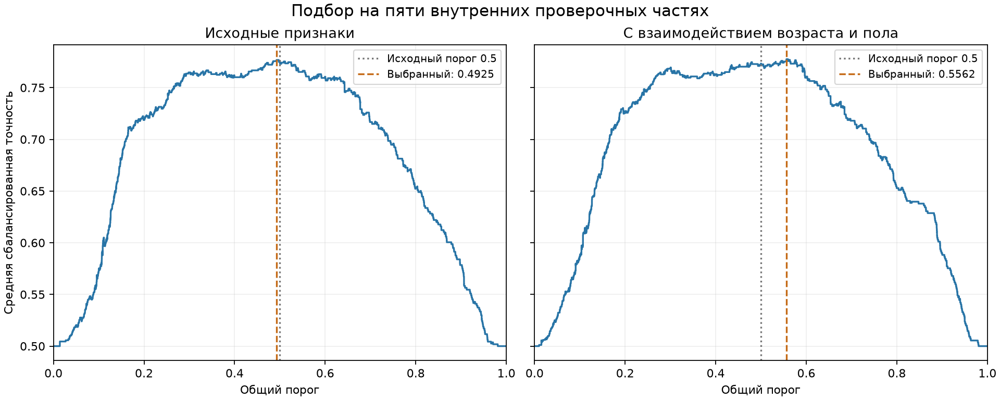
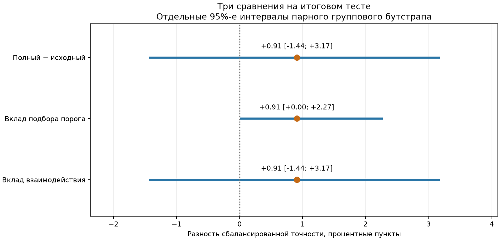
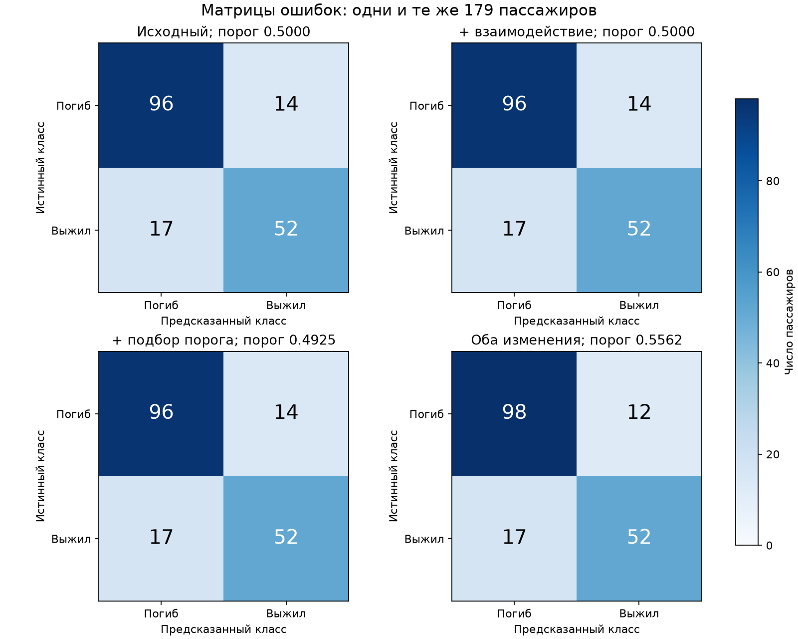

# Titanic: взаимодействие возраста и пола и подбор порога

Серия: `20261125T205316Z-19541605`. Данные и версии: [series.json](series.json).

## Гипотезы и контролируемые условия

1. Фиксированный порог 0.5 не выбирался под сбалансированную точность. Подбор одного общего порога может улучшить баланс полноты двух классов.
2. Дополнительный признак `Age * male` может учесть различную связь возраста с выживанием у мужчин и женщин. Исходный возраст сохраняется; это дополнительный коэффициент, а не замена возраста женщин нулями. До масштабирования возрастной вклад в линейной части равен `a * Age + c * Age * male`.

Наблюдение исходной модели — только 1 распознанный выживший мужчина из 18 — мотивировало эти проверки, но само по себе не объясняет причины ошибок.

Во всех вариантах используется логистическая регрессия с `C=1`, `class_weight=None`, L2-регуляризацией и прежними настройками решателя. Нового поиска этих параметров нет. Остальные семь признаков и их обработка одинаковы. Для взаимодействия пропущенный возраст заполняется медианой обучающей части до умножения; масштабирование также обучается только на ней.

Сохранены точные разбиения исходного эксперимента: 712 пассажиров для разработки, 179 для итогового теста. Все пассажиры с общим билетом остаются вместе. Пять внутренних проверочных частей: 144, 142, 143, 142 и 141 пассажир; параметр случайности — 42.

## Подбор порога и защита от утечек

Для каждого набора признаков пять моделей предсказывают вероятность только для своей отложенной части. Каждый из 712 пассажиров получает ровно одно такое предсказание. Подготовка признаков обучается внутри соответствующей обучающей части.

Кандидаты — уникальные неокруглённые проверочные вероятности плюс 0, 0.5 и 1. Для каждого общего порога считается обычное среднее пяти значений сбалансированной точности, без взвешивания частей. Пять оптимальных порогов не усредняются. Метка 1 получается только при `probability > threshold`. Среди равных максимумов выбирается ближайший к 0.5 порог, затем меньший. Наборы признаков имеют собственные пороги.

После выбора каждая итоговая модель заново обучается на всех 712 пассажирах. Всего выполнено 12 обучений: по пять внутренних и одному итоговому для двух наборов признаков. Варианты с одним набором признаков используют одну модель и одинаковые вероятности. Сравнение на тесте выполняется после фиксации порогов. Метрики подбора отделены от итоговых.

## Результаты четырёх вариантов

Основная метрика — сбалансированная точность: среднее полноты классов погибших и выживших. Значения в таблице округлены только для чтения; полная точность — в [experiments.csv](experiments.csv).

| Вариант | Порог | Среднее пяти проверок | Тест | Полнота погибших | Полнота выживших |
| --- | ---: | ---: | ---: | ---: | ---: |
| Исходный | 0.500000 | 0.774907 | 0.813175 | 0.872727 | 0.753623 |
| + взаимодействие | 0.500000 | 0.773243 | 0.813175 | 0.872727 | 0.753623 |
| + подбор порога | 0.492506 | 0.776759 | 0.813175 | 0.872727 | 0.753623 |
| Оба изменения | 0.556210 | 0.777521 | 0.822266 | 0.890909 | 0.753623 |

Исходный вариант воспроизвёл файл предсказаний ДЗ1 побайтно, включая порядок пассажиров, вероятности и метки. Рост внутреннего максимума после подбора порога не является независимым доказательством улучшения.

## Общий эффект и две абляции

В абляции порога сравниваются одна модель и одинаковые вероятности, меняется только порог. В абляции признака модель без взаимодействия обучается отдельно, а её собственный порог выбирается тем же способом. Полная версия означает наличие двух компонентов и не обязательно является лучшей.

| Сравнение | Разность, п.п. | 95%-й интервал, п.п. |
| --- | ---: | ---: |
| Полный − исходный | +0.909 | [-1.442; +3.175] |
| Вклад подбора порога | +0.909 | [+0.000; +2.273] |
| Вклад взаимодействия | +0.909 | [-1.442; +3.175] |

П.п. — процентные пункты. Интервалы получены парным бутстрапом 136 билетных групп: 2000 повторов, выбор с возвращением, параметр случайности 42. В каждом повторе все варианты используют одни и те же выбранные группы со всеми пассажирами и кратностью выбора. Модели и пороги фиксированы. Границы — квантили 0.025 и 0.975 разностей с линейной интерполяцией. Неопределённых повторов не было; такой повтор прерывает расчёт, а не удаляется.

## Выводы

- **Полный − исходный:** +0.909 процентного пункта. Интервал включает ноль; убедительного различия на этом тесте не установлено.
- **Вклад подбора порога:** +0.909 процентного пункта. Интервал включает ноль; убедительного различия на этом тесте не установлено.
- **Вклад взаимодействия:** +0.909 процентного пункта. Интервал включает ноль; убедительного различия на этом тесте не установлено.

Добавление взаимодействия при пороге 0.5: наблюдаемая разность +0.000 процентного пункта. Полнота погибших изменилась с 0.8727 до 0.8727, выживших — с 0.7536 до 0.7536. Это описательное сравнение; отдельный интервал для этой пары не рассчитывался.

Подбор порога на исходных признаках: наблюдаемая разность +0.000 процентного пункта. Полнота погибших изменилась с 0.8727 до 0.8727, выживших — с 0.7536 до 0.7536. Это описательное сравнение; отдельный интервал для этой пары не рассчитывался.

Подбор порога при наличии взаимодействия: число пропущенных выживших 17 → 17, ложных прогнозов выживания 14 → 12. Эти числа показывают изменение каждого типа ошибок отдельно.

Добавление взаимодействия при сохранении процедуры подбора: число пропущенных выживших 17 → 17, ложных прогнозов выживания 14 → 12. Эти числа показывают изменение каждого типа ошибок отдельно.

Матрицы ниже показывают, какие ошибки изменились. Выигрыш в полноте одного класса может сопровождаться потерей в другом. Связь возраста с полом здесь предсказательная; причинных выводов из коэффициентов нет.

## Ограничения

- Итоговый тест уже изучался в ДЗ1 и участвовал в формировании гипотез. Это прозрачное повторное сравнение, но не новая полностью независимая проверка.
- Лучшие настройки модели ранее выбраны на данных разработки; они фиксированы и не переоптимизируются для расширенного набора признаков.
- Интервалы условны при фиксированных моделях и порогах. Они не включают разброс обучения и подбора и являются тремя отдельными интервалами, а не совместной 95%-й гарантией. Наличие нуля в интервале не доказывает равенство.
- Небольшой исторический набор и билетные группы ограничивают переносимость выводов.

## История и воспроизведение

Полный запуск: `bash scripts/run_hw2.sh`. Новая попытка получает отдельный каталог и четыре записи в локальном MLflow. База SQLite и файлы находятся в `artifacts/mlflow/`; история серий — в `artifacts/hw2/runs/`. Интерфейс: `uv run --locked python -m src.hw2 ui` (http://127.0.0.1:8080).

В каждой записи сохранены гипотеза, конфигурация, версии, контрольные суммы, раздельные внутренние и тестовые метрики, таблицы порогов, предсказания и рисунки. Этапы дополняют те же четыре записи. Неудачные этапы отмечаются отдельно. Текущая выгрузка читается без запуска MLflow.

Воспроизводимость и проверки: [verification.json](verification.json). Успех запуска и совпадение повторов следует проверять по этому файлу, а не предполагать по наличию отчёта.

Источники: [условие ДЗ2](https://github.com/PikaChuChuMF/RnD-ML-Course-2026-2/blob/main/HW_2/HomeWork_2.md), [Titanic](https://www.kaggle.com/competitions/titanic), [MLflow](https://mlflow.org/docs/latest/ml/tracking/).
